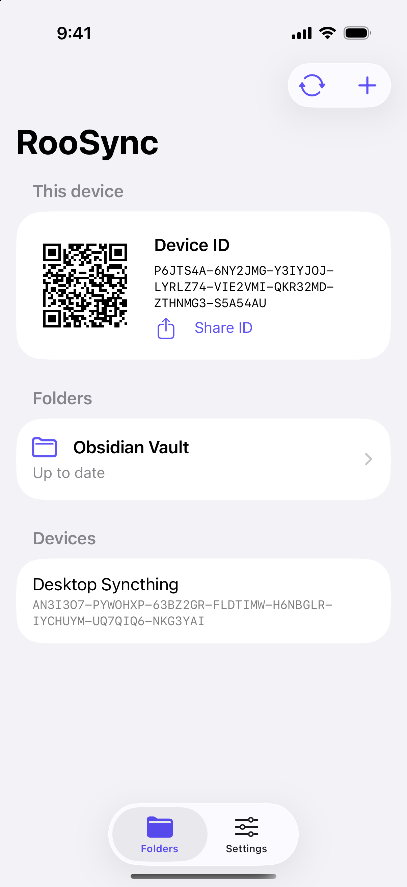
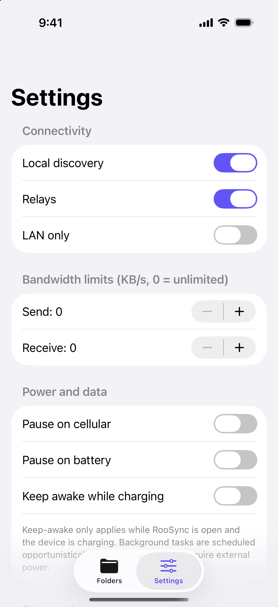

# RooSync

RooSync is a native iOS client for [Syncthing](https://syncthing.net/). It
syncs files directly between your devices; RooSync has no accounts, analytics,
tracking, or cloud storage. The iOS app is SwiftUI, and the official Syncthing
Go core is embedded as a gomobile XCFramework and controlled through its local
REST API.

**Author: Roo Industries · License: MPL-2.0 · iOS 18+**

## Screenshots

Screenshots from the UI validation handoff will be checked in under
`docs/screenshots/`. The image slots below can be replaced with the captured
device setup, folder list, and settings screens once visual review is complete.

<!--



-->

## What works

- Show this device's Syncthing ID and QR code; add peers by ID or QR.
- Manage folders in RooSync's Files-visible `Documents` directory or choose an
  external folder through the iOS document picker.
- View folder state, scan/rescan, pause, share, and accept incoming device or
  folder offers.
- Configure ignore patterns, inspect Syncthing conflict files, network
  discovery/relay settings, bandwidth, and cellular/battery policies.
- Export Syncthing logs and trigger **Sync now** from Shortcuts.

## Install from source

Requirements: macOS, Xcode 16 or newer with the iOS 18 SDK, Go 1.26+, and
`xcodegen`. A free Apple Personal Team can sign and sideload the app from Xcode.

```sh
brew install go xcodegen
./Scripts/build-core.sh
xcodegen generate
open RooSync.xcodeproj
```

In Xcode, select the RooSync target, choose **Signing & Capabilities**, select
your Personal Team, then run on a connected iPhone. For an unsigned simulator
build:

```sh
xcodebuild -project RooSync.xcodeproj -scheme RooSync \
  -destination 'generic/platform=iOS Simulator' \
  CODE_SIGNING_ALLOWED=NO build
```

RooSync uses no paid Apple entitlements. A Personal Team still requires the
user's Apple ID to sign and install the app; free provisioning normally expires
after seven days, so the app must be re-signed/reinstalled from Xcode to renew
the profile. This repository does not include a signing identity or profile.

The core build script downloads the pinned, official Syncthing source and the
official `golang.org/x/mobile` gomobile tool. Generated framework binaries are
not committed; the script creates `Frameworks/RooSyncCore.xcframework`.

## Background sync: iOS limits

RooSync syncs continuously while the app is foregrounded. iOS normally suspends
apps shortly after they enter the background; RooSync cannot promise continuous
or scheduled background synchronization.

- `BGAppRefreshTask` requests short refresh windows. iOS chooses whether and
  when to run them.
- `BGProcessingTask` is requested with external power required. It is still
  opportunistic, can be delayed or interrupted, and is not a keep-alive service.
- **Keep awake while charging** only disables the idle timer while RooSync is
  foregrounded and the device reports that it is charging. It does not keep the
  app running after backgrounding.
- The **Sync now** App Intent can be run from Shortcuts or an automation, but
  the invocation receives only the runtime iOS grants it.
- Background App Refresh settings, Low Power Mode, force-quitting RooSync, and
  iOS resource management can prevent or defer background work.

Treat background execution as a best-effort refresh, not a replacement for an
always-on Syncthing peer. Keep another device online when timely delivery
matters.

## Obsidian and folder access

RooSync's own `Documents` directory is exposed in Files using
`UIFileSharingEnabled` and `LSSupportsOpeningDocumentsInPlace`. iOS also lets a
user grant RooSync access to a folder exposed by the Files document picker;
RooSync stores a security-scoped bookmark and retains access while its core is
running.

That grant is **not** a guarantee that another app can open the same folder.
Obsidian's current iOS guidance recommends its own `Obsidian` folder under
`On My iPhone` or `iCloud Drive/Obsidian`. A RooSync folder under
`On My iPhone/RooSync` is not automatically an Obsidian vault. If the Files
picker exposes `On My iPhone/Obsidian` to RooSync, a user can grant RooSync that
folder; whether Obsidian can open a RooSync-owned or externally synchronized
folder depends on Obsidian's iOS vault flow and the provider. Verify the vault
in Obsidian before relying on that layout. Cloud-backed Files providers can
also require coordinated access; RooSync's Syncthing core operates on file
paths, so use a local folder for the most predictable behavior.

**Validation gap:** The simulator-to-Docker test does not launch Obsidian or
exercise the Files picker and security-scoped bookmark flow. No physical iPhone
test has confirmed that Obsidian can open a RooSync-owned or bookmark-granted
vault; verify that workflow on the intended device before relying on it.

## RooSync and Möbius Sync

| | RooSync | Möbius Sync |
|---|---|---|
| Price and source | Free, open source (MPL-2.0) | Paid, proprietary |
| Sync protocol | Official Syncthing Go core | Syncthing-based |
| UI | Native SwiftUI | Native iOS app |
| Background execution | Best-effort iOS scheduled windows | Subject to iOS background limits |
| Data handling | Local device configuration; no RooSync account or cloud | See its current product and privacy information |

Both apps are subject to iOS suspension and background scheduling. RooSync is
not a promise of always-on iPhone synchronization.

## Build and end-to-end checks

GitHub Actions builds the iOS app on macOS and runs simulator end-to-end checks
against a desktop Syncthing peer in Docker. The test asserts files arriving in
both directions and verifies conflict-file handling.

```sh
./Scripts/build-core.sh
xcodegen generate
./Scripts/e2e.sh
```

The end-to-end script requires Xcode, an iOS Simulator runtime, and a working
Docker engine. On a macOS host without nested virtualization, start Colima with
its QEMU backend (`colima start --vm-type qemu --runtime docker`); the script
uses Lima SSH forwarding for the Docker peer. The GitHub Actions `macos-15`
Apple Silicon runner also uses QEMU rather than Apple's nested virtualization.
The script pairs the simulator app's embedded core with a Docker Syncthing peer,
checks a sample vault in both directions, creates a concurrent-edit conflict,
and exercises **Keep copy** in the app's UI test. It does not produce screenshots.

Local validation on 2026-11-24 used Xcode 26.6, an iOS 27.0 simulator, and the
Syncthing 2.1.7 Docker peer. `./Scripts/e2e.sh` completed with nine UI tests and
zero failures. It verified the local device remains in core configuration with
the name RooSync while peer controls hide it, self-add rejection, API-key access
and denial of the root-cookie/CSRF bypass, duplicate external-folder rejection
without configuration changes, accepting an offer for an existing folder,
safe paths for empty and slash-containing labels, pause/resume, two-way vault
sync, Markdown and extensionless conflicts, and Keep-copy convergence on both
peers. This simulator-only result is not a physical-device or Obsidian
interoperability test.

The workflow also builds an unsigned arm64 device product and publishes its app
bundle, unsigned IPA, and source archive. The app bundle and source archive
include the pinned dependency license texts. For local release artifacts, run
the same Release device build and then `Scripts/package-artifacts.sh`; outputs
default to `~/RooSync-artifacts/`, outside the checkout.

CI includes the pinned Syncthing dependency license texts in the source archive
under `third_party_licenses/`; see
[`THIRD_PARTY_NOTICES.md`](THIRD_PARTY_NOTICES.md).

## App Store follow-up

Before submission, add and validate a privacy manifest for the APIs used by the
embedded core, confirm the final dependency privacy declarations, prepare review
notes explaining the user-visible `processing` background mode and its
best-effort behavior, and test signing, export-compliance answers, and the
external-folder workflow on physical devices. Background modes do not guarantee
continuous synchronization.

Copyright 2026 Roo Industries.
